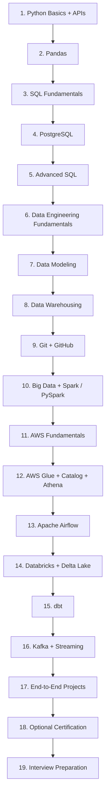
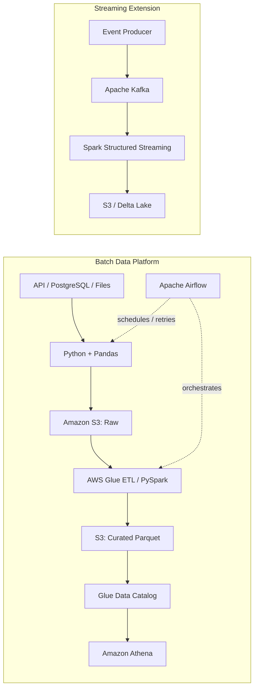
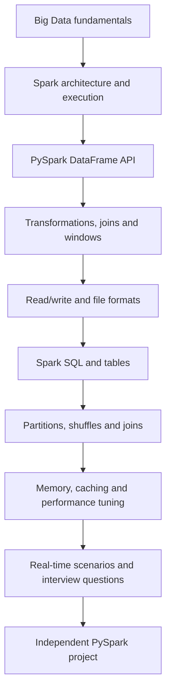
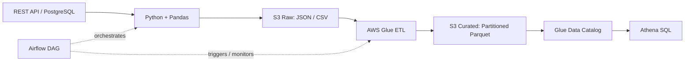
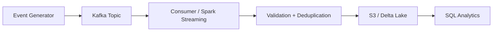

# Data Engineering Roadmap — AWS Track (Customized)

> **Purpose:** A practical, free-first roadmap for a Data Engineer fresher. The learning order is deliberately arranged as **Python basics → Pandas → SQL → PostgreSQL → advanced SQL → Data Engineering fundamentals → data modeling → data warehousing → Git → PySpark → AWS → Airflow → Databricks/dbt/Kafka → projects and interviews**.
>
> **Attribution:** This is an independent customized roadmap inspired by the public [Ansh Lamba Data Engineering Roadmap](https://github.com/anshlambagit/Data_Engineer_Roadmap). Ansh Lamba's videos and repository remain his work. Resources are linked rather than copied wholesale. Azure-focused cloud learning is replaced with AWS; PostgreSQL, Pandas, advanced SQL, Airflow, and Kafka are explicitly added or expanded.

## Roadmap at a glance

### Batch and streaming architecture

## How to use this roadmap

- **Follow the sequence.** Do not start every tool at once.
- **Watch, code, explain.** A video is complete only when you can rebuild the main idea without copying.
- **Build one small artifact per module.** Push source code, a helpful README, sample data, and screenshots to GitHub.
- **Use free resources first.** Paid courses and certifications are optional.
- **Already learned:** Python, Requests, REST APIs, and basic Pandas have been covered. Revise gaps and concentrate on applying them in pipelines instead of repeating every beginner lesson.
- **Cloud cost safety:** check AWS pricing before creating resources, use eligible free-tier benefits only where applicable, avoid leaving paid resources running, and delete test resources when finished. Never commit credentials or secrets.

---

# Module 1 — Python Basics and APIs

### Topics
- Python syntax, variables, collections, conditions, loops and functions
- Files, modules, exceptions, reusable code and basic OOP
- Reading/writing CSV and JSON
- Calling REST APIs with `requests`, query parameters, headers, pagination and status codes
- Basic logging, environment variables and safe handling of API keys
- Basic command line usage and virtual environments

### Ansh Lamba resources
- [Python for Data Engineers — Ansh Lamba](https://youtu.be/ZvU7lupoXQE)
- [Ansh Lamba Data Engineering Roadmap](https://github.com/anshlambagit/Data_Engineer_Roadmap)

### Completion check
- Write a script that calls an API, checks status codes, validates the response, and saves JSON.
- Handle API errors and keep secrets out of the source code.

# Module 2 — Pandas for Data Engineering

> You already know basic Pandas. Use this module as targeted revision and pipeline practice rather than rewatching every beginner lesson.

### Topics
- Series, DataFrames, data types, selecting, filtering and sorting
- Missing values, duplicates, type conversion and validation rules
- `merge`, `concat`, `groupby`, aggregations and datetime handling
- Read/write CSV, JSON, SQL and Parquet
- Chunked reading, memory-aware processing and avoiding unnecessary copies
- Data-quality checks, rejected rows and useful error reporting
- Load transformed results into PostgreSQL and/or Amazon S3

### Free resources
- [Pandas getting-started tutorials](https://pandas.pydata.org/docs/getting_started/intro_tutorials/)
- [Pandas user guide](https://pandas.pydata.org/docs/user_guide/)
- [Corey Schafer Pandas tutorial playlist](https://www.youtube.com/playlist?list=PL-osiE80TeTsWmV9i9c58mdDCSskIFdDS)

### Mini-project
Take API/CSV data → clean and validate with Pandas → write clean rows to a CSV/Parquet output. Log input row counts, output row counts and rejected records. You will load the same data into PostgreSQL in a later module.

# Module 3 — SQL Fundamentals

Start with database-agnostic SQL and practise against sample tables before going deeper into PostgreSQL.

### Topics
- `SELECT`, `WHERE`, `ORDER BY`, `LIMIT`, aliases and `DISTINCT`
- Filtering with `IN`, `BETWEEN`, `LIKE`, and correct `NULL` handling
- Aggregations: `COUNT`, `SUM`, `AVG`, `MIN`, `MAX`; `GROUP BY` and `HAVING`
- `INNER`, `LEFT`, `RIGHT` and `FULL OUTER` joins
- Subqueries, `CASE WHEN`, set operations (`UNION`, `UNION ALL`)
- Primary/foreign key concepts and how tables relate

### Ansh Lamba resource
- [SQL Full Course for Data Engineers — Ansh Lamba](https://youtu.be/YimMzb0mHkI)

### Practice
- Solve easy queries first, then multi-table reporting questions.
- Use a small orders/customers/products dataset and explain each query in plain language.

### Completion check
- Write queries using joins, grouping, filtering and `CASE WHEN` without copying a solution.

# Module 4 --- PostgreSQL for Data Engineers

### PostgreSQL-specific topics

PostgreSQL is the database engine you will practise in. SQL is the language; PostgreSQL is one database system that implements it, with its own tooling and features.

-   Install/connect to PostgreSQL; databases, schemas, tables and data
    types
-   CRUD, filtering, sorting, NULLs, constraints, primary/foreign keys
-   Joins, aggregates, CTEs, subqueries and window functions
-   Indexes, transactions, `EXPLAIN` / `EXPLAIN ANALYZE`
-   Normalization and basic query tuning
-   Connect Python to PostgreSQL; parameterized queries; environment
    variables
-   Load raw data, deduplicate records, and implement incremental
    extraction with a timestamp or increasing ID

### Free resources

-   [PostgreSQL official
    tutorial](https://www.postgresql.org/docs/current/tutorial.html)
-   [freeCodeCamp PostgreSQL
    course/article](https://www.freecodecamp.org/news/posgresql-course-for-beginners/)
-   [SQL course by Ansh Lamba](https://youtu.be/YimMzb0mHkI) --- use for
    SQL concepts; practice PostgreSQL-specific syntax separately.

### Mini-project

Create `customers`, `orders`, and `order_items` tables; write analytical
queries; connect from Python; extract rows updated since the previous
successful run.

# Module 5 — Advanced SQL and Query Practice

SQL appears in two stages on purpose: learn the syntax first, practise using a real PostgreSQL database next, then return for advanced interview and performance patterns.

Now return to SQL after setting up PostgreSQL. The focus is on the patterns regularly used in analytics and Data Engineering interviews.

### Topics
- CTEs (`WITH`), recursive CTE awareness, subqueries and correlated subqueries
- Window functions: `ROW_NUMBER`, `RANK`, `DENSE_RANK`, `LAG`, `LEAD`, running totals and rolling metrics
- Deduplication and “latest row per key” patterns
- Date/time functions, time-based aggregations and gap detection
- Conditional aggregates and pivot-style reporting
- Transactions, indexes and query plans in PostgreSQL
- `EXPLAIN` / `EXPLAIN ANALYZE`, basic index selection and query tuning
- Incremental extraction patterns using timestamps or monotonically increasing IDs

### Resources
- [Ansh Lamba — SQL Full Course for Data Engineers](https://youtu.be/YimMzb0mHkI)
- [PostgreSQL official tutorial](https://www.postgresql.org/docs/current/tutorial.html)
- [PostgreSQL — EXPLAIN documentation](https://www.postgresql.org/docs/current/using-explain.html)

### Required practice set
- Find the latest order for each customer.
- Find top 3 products in each category.
- Deduplicate events and retain the latest valid version of each event.
- Calculate daily revenue and a 7-day rolling total.
- Explain a query plan and compare query behavior before/after an index where appropriate.

# Module 6 — Data Engineering Fundamentals

### Topics
- What Data Engineers do; operational sources vs analytical destinations
- ETL vs ELT; batch vs streaming; ingestion vs transformation vs serving
- Structured, semi-structured and unstructured data
- Data pipelines, dependencies, reliability and observability
- Full load vs incremental load; idempotency and replayability
- Data quality, validation, schema changes and late-arriving data
- Orchestration vs processing: why Airflow, Spark and Kafka solve different problems
- Data lakes, warehouses and lakehouses at a conceptual level (detailed modules follow)

### Ansh Lamba resources
- [Fundamentals of Data Engineering Masterclass](https://youtu.be/ZRz-7E-7X7c)
- [Ansh Lamba original roadmap](https://github.com/anshlambagit/Data_Engineer_Roadmap)

### Completion check
Draw a pipeline from API or database to analytics. Explain the purpose of every component and what happens if extraction or transformation fails.

# Module 7 — Data Modeling

### Topics
- Entities, attributes, keys, relationships and normalization
- OLTP vs OLAP and why operational schemas differ from analytical schemas
- Facts and dimensions; grain of a fact table
- Star schema vs snowflake schema; when each is useful
- Surrogate keys vs natural keys
- Slowly Changing Dimensions (SCD) Type 1 and Type 2
- Handling duplicates, late-arriving dimensions and historical changes
- Model customers, orders, products, payments and order items

### Ansh Lamba resource
- [Data Modeling Masterclass for Data Engineers](https://youtu.be/K7C1sWKQU-o)

### Completion check
Design a star schema for e-commerce orders. State the grain of each table and explain how a changed customer address should be handled.

# Module 8 — Data Warehousing and Lakehouse Fundamentals

### Topics
- What a data warehouse is and how it differs from a transactional database
- OLTP vs OLAP, analytical workloads and dimensional modeling
- Warehouse architecture: staging, integration, presentation/marts
- Data warehouse vs data lake vs lakehouse
- Batch ingestion, transformation layers and serving/BI layer
- Partitioning, columnar formats and compression at a conceptual level
- Warehouse load patterns: full refresh, incremental load and CDC concepts
- Data marts, metrics consistency, governance, lineage and access control
- Cost/performance trade-offs and why Parquet can suit analytical scans

### Ansh Lamba resource
- [Fundamentals of Data Engineering Masterclass](https://youtu.be/ZRz-7E-7X7c)
- [Original roadmap and related warehouse content](https://github.com/anshlambagit/Data_Engineer_Roadmap)

### Completion check
Draw a warehouse/lakehouse architecture showing raw, transformed and curated data, a dimensional model, and a SQL analytics/BI consumer.

# Module 9 --- Git and GitHub

**Original roadmap module --- keep it.**

### Topics

-   `clone`, `status`, `add`, `commit`, `push`, `pull`
-   Branches, merge conflicts, `.gitignore`
-   Good commit messages, README writing, repository structure
-   Secrets management: never commit `.env`, credentials, tokens, or AWS
    keys

### Ansh Lamba resource

-   [Complete Git and GitHub Tutorial for Data
    Engineers](https://youtu.be/Kr8l7rQGwNs)

### Completion check

-   Create a public portfolio repository with a clean README, source
    code, setup steps, and architecture diagram. Keep secrets out of Git
    history.

# Module 10 --- Big Data Engineering + Apache Spark + PySpark

**Original Ansh Lamba module — keep it, and give it proper time.** This module was too short in the earlier version of this README. The original roadmap has four separate learning resources here: Big Data fundamentals, Apache Spark, a full PySpark course, and real-time scenario practice. Do not treat PySpark as just a list of DataFrame functions.

## Recommended sequence

## 10.1 Big Data Engineering fundamentals

### Learn
- Why distributed processing is needed; vertical vs horizontal scaling
- Distributed storage and compute concepts; when a single machine is enough
- Batch processing vs stream processing
- High-level comparison of Hadoop MapReduce and Apache Spark
- Data lake, data warehouse and lakehouse roles in a data platform

### Ansh Lamba video
- [Big Data Engineer Masterclass for Beginners](https://youtu.be/H5SHmiKTFsM)

**Completion check:** explain when Pandas is sufficient and when distributed Spark processing is justified. Avoid using Spark just because the dataset is small.

## 10.2 Apache Spark architecture and execution

### Learn
- Spark application, driver, executor, cluster manager and worker nodes
- `SparkSession`, configuration basics and execution environments
- Lazy evaluation; transformations vs actions
- Jobs, stages and tasks; DAG and query plan basics
- Narrow vs wide transformations
- Spark UI: stages, task duration, shuffle, skew and failed tasks
- RDD concept and when the DataFrame API is preferred

### Ansh Lamba video
- [Apache Spark — The Ultimate Guide (From Zero to Pro)](https://youtu.be/FNJze2Ea780)

**Important timestamps from the published video outline:** architecture 33:36; Spark Session 1:06:55; lazy evaluation/actions 1:17:56; query plans and Spark UI 1:32:58; RDDs 1:39:27; narrow/wide transformations 1:49:49; jobs/stages/tasks 2:17:54.

## 10.3 PySpark Zero to Hero — core coding course

### Learn in this order
1. Setup: Databricks notebook or a suitable local Spark environment; `SparkSession`
2. Reading data: CSV, JSON, Parquet; schema inference vs explicit schema
3. `StructType`, `StructField`, DDL schemas, nullable fields and data types
4. Selecting/renaming columns, aliases, literals and expressions
5. Filtering, sorting, `drop`, `withColumn`, `withColumnRenamed`, `cast`
6. Conditional logic with `when` / `otherwise`; null handling with `isNull`, `coalesce`, `fillna`, `dropna`
7. String functions, date/timestamp functions, numeric functions and type conversion
8. Aggregations with `groupBy`, `agg`, `count`, `sum`, `avg`, `min`, `max`, `countDistinct`
9. Joins: inner, left/right/full, semi, anti; duplicate column names and join-key cleanup
10. Union and set operations; arrays, structs and nested JSON basics
11. Window functions: `row_number`, `rank`, `dense_rank`, `lag`, `lead`, running totals and deduplication
12. User-defined functions (UDFs): understand use cases and overhead; prefer built-in Spark functions where possible
13. Writing data, write modes (`append`, `overwrite`, `ignore`, `error`), partitioned writes and output formats
14. Parquet basics; managed vs external tables; Spark SQL and querying tables

### Ansh Lamba full course
- [PySpark Tutorial — Full Course (From Zero to Pro, approx. 6 hours)](https://youtu.be/94w6hPk7nkM)
- [Course notebook and sample data repository](https://github.com/anshlambagit/PySpark-Full-Course)

**Published chapter guide:** Spark basics 3:47; architecture 5:33; lazy evaluation 10:47; jobs/stages/tasks 12:51; data ingestion 20:03; reading data 23:36; reader API 27:46; schemas 43:00; beginner transformations 56:00; intermediate transformations 1:53:37; advanced functions 3:21:51; window functions 4:22:09; UDFs 4:52:20; writing data 5:02:10; write modes 5:09:59; Parquet 5:23:33; managed vs external tables 5:35:34; Spark SQL 5:46:49.

## 10.4 Spark performance and optimization

### Learn after basic transformations are comfortable
- `repartition()` vs `coalesce()`; partition sizing and avoiding too many small files
- Shuffle: why it happens and why it can be expensive
- Broadcast joins vs shuffle joins; when a broadcast join is suitable
- Data skew, long-running tasks and salting concepts
- Cache vs persist; only persist data when reuse justifies the cost
- Driver and executor memory; executor out-of-memory symptoms and first debugging steps
- Adaptive Query Execution (AQE), dynamic partition pruning and query plans
- Spark SQL engine basics and practical use of `explain()` / Spark UI
- Avoid collecting large datasets to the driver; understand the risk of `collect()` and oversized `toPandas()` calls

### Ansh Lamba video
- [Apache Spark — The Ultimate Guide (From Zero to Pro)](https://youtu.be/FNJze2Ea780)

**Published chapter guide:** repartition vs coalesce 2:10:10; shuffle joins 2:47:58; broadcast joins 3:12:28; Spark SQL engine 3:33:51; driver memory 3:41:07; executor memory 3:52:15; out-of-memory 4:13:16; salting 4:24:16; cache/persist 4:29:58; deployment modes 4:55:23; dynamic partition pruning 5:08:49; AQE 5:28:49.

## 10.5 Real-time PySpark scenarios and interview practice

Work through these only after learning the DataFrame API:
- Keep the latest record for each business key using a timestamp and window function
- Remove duplicates while handling nulls and tie-breaking deterministically
- Find each customer's latest order and top N items per category
- Identify consecutive dates, running totals and rolling aggregates
- Join a large fact dataset with a small dimension; explain the join strategy
- Diagnose data skew, too many small files, slow shuffles and failed tasks
- Read a changing schema and safely handle bad records
- Incrementally transform data without accidentally duplicating previous output

### Ansh Lamba videos
- [PySpark Real-Time Scenarios for Big Data Engineers](https://youtu.be/-Gvnm9eS8v8)
- [PySpark Interview Questions (2025) and Real-Time Scenarios](https://youtu.be/fOCiis31Ng4)

**Practice rule:** pause before the solution, write the transformation yourself, test it on at least one edge case, and then compare. Watching the answer is not the same as solving the problem.

## 10.6 Structured Streaming — learn later, after batch PySpark

Keep Structured Streaming separate from core batch PySpark. First become comfortable with DataFrames, joins, aggregations, schemas and writing data.

### Learn
- Streaming DataFrames and input sources/sinks
- Event time vs processing time; windows and watermarks
- Checkpoints and restart/recovery behavior
- Late-arriving and duplicate events
- Output modes and delivery semantics at a practical level
- Kafka integration only after Kafka producer/consumer basics are understood

### Ansh Lamba resource
- [PySpark Streaming Full Course — Big Data with Apache Spark](https://youtu.be/r7FTCuTl84g)
- [Official Spark Structured Streaming guide](https://spark.apache.org/docs/latest/structured-streaming-programming-guide.html)

## PySpark project — required before moving on

**Project: Retail orders batch pipeline**
- Read order, customer and product CSV/JSON files with explicit schemas.
- Clean invalid rows and nulls; standardize timestamps and types.
- Deduplicate orders by business key and latest update timestamp.
- Join fact and dimension datasets and create daily/category-level metrics.
- Use window functions for latest order and top-N analysis.
- Write partitioned Parquet; justify the partition column and write mode.
- Compare a regular join with a broadcast join when appropriate.
- Capture `explain()` output or Spark UI screenshots and explain at least one optimization decision.
- Add a README with setup steps, schema, data-quality rules and example output.

### Module 10 completion checklist
- [ ] I can explain driver, executor, job, stage and task.
- [ ] I can read data with an explicit schema and transform it without copying a solution.
- [ ] I can use joins, aggregations, windows, null handling and date/string functions.
- [ ] I can write CSV/JSON/Parquet and explain write modes and partitioning.
- [ ] I can explain shuffle, broadcast joins, skew, cache/persist and AQE at a junior interview level.
- [ ] I have independently finished the retail orders project.
- [ ] I have solved at least 10 real-world PySpark scenarios.

### Official documentation
- [Apache Spark documentation](https://spark.apache.org/docs/latest/)
- [PySpark API reference](https://spark.apache.org/docs/latest/api/python/)
- [Spark SQL and DataFrames guide](https://spark.apache.org/docs/latest/sql-programming-guide.html)
- [Ansh Lamba's PySpark course repository](https://github.com/anshlambagit/PySpark-Full-Course)

# Module 11 --- AWS Fundamentals for Data Engineers (Replaces Azure)

### Learning order

1.  Cloud concepts, regions/AZs, shared responsibility, pricing basics
2.  IAM users, roles, policies, least privilege
3.  S3 buckets, prefixes, object permissions, versioning and lifecycle
4.  AWS CLI and `boto3`
5.  EC2 basics (understand the service; don't leave instances running)
6.  Lambda fundamentals and event triggers
7.  CloudWatch logs/metrics; AWS cost and security basics

### Ansh Lamba resources

-   [AWS Tutorial for Beginners (2026 Guide) --- Ansh
    Lamba](https://www.youtube.com/watch?v=Ae3xyW2Ef0c)
-   [AWS Glue Full Course for Beginners --- Ansh
    Lamba](https://www.youtube.com/watch?v=Pigx0gReuT4)

### Official resources

-   [AWS Skill Builder](https://skillbuilder.aws/)
-   [Amazon S3 documentation](https://docs.aws.amazon.com/s3/)
-   [IAM documentation](https://docs.aws.amazon.com/iam/)
-   [Boto3
    documentation](https://boto3.amazonaws.com/v1/documentation/api/latest/index.html)

### Mini-project

Use `boto3` to upload a sample dataset to an S3 raw prefix,
list/download it, and record a manifest. Use an IAM role/policy with
minimum required permissions.

# Module 12 --- AWS Data Lake, Glue, Catalog and Athena

### Topics

-   S3 lake layout: `raw/`, `processed/`, `curated/`
-   Glue Data Catalog, databases, tables and crawlers
-   AWS Glue ETL jobs with Python/PySpark
-   CSV/JSON → Parquet; compression and partitioning
-   Schema changes, bad records, incremental loads and job bookmarks
-   Athena external tables, SQL queries, partition pruning and cost
    awareness
-   Glue triggers/workflows; Lambda/EventBridge integration basics
-   CloudWatch logs, retries, permissions and failure diagnosis
-   Redshift fundamentals after the S3/Glue/Athena workflow is clear

### Ansh Lamba resources

-   [AWS masterclass --- includes S3, IAM, Glue and
    Athena](https://www.youtube.com/watch?v=Ae3xyW2Ef0c)
-   [AWS Glue deep dive --- includes Catalog, crawlers, partitioning,
    incremental loading and
    workflows](https://www.youtube.com/watch?v=Pigx0gReuT4)

### Official resources

-   [AWS Glue documentation](https://docs.aws.amazon.com/glue/)
-   [AWS Glue getting
    started](https://docs.aws.amazon.com/glue/latest/dg/getting-started.html)
-   [Amazon Athena user
    guide](https://docs.aws.amazon.com/athena/latest/ug/what-is.html)

### Mini-project

Create a Glue job that transforms raw JSON/CSV in S3 into partitioned
Parquet, registers it in the Glue Catalog, and queries it using Athena.
Test a bad file and a schema change.

# Module 13 --- Apache Airflow: Workflow Orchestration

### Why it matters

Airflow schedules and coordinates tasks; it is not a replacement for
Spark, Glue, or Kafka. It can trigger a pipeline, enforce task
dependencies, retry failures, and provide run history.

### Topics

-   DAGs, tasks, dependencies and scheduling
-   Operators and TaskFlow API
-   Retries, timeouts, sensors, backfills and catchup
-   Connections, variables and secret handling
-   Logging, task failure debugging and idempotent tasks
-   Airflow with Python, PostgreSQL and AWS services
-   Local setup with Docker; avoid an unnecessary always-on cloud
    deployment while learning

### Free resources

-   [Apache Airflow official
    tutorials](https://airflow.apache.org/docs/apache-airflow/stable/tutorial/index.html)
-   [Airflow: building your first
    workflow](https://airflow.apache.org/docs/apache-airflow/stable/tutorial/fundamentals.html)
-   [Astronomer Academy --- Airflow learning
    resources](https://www.astronomer.io/academy/)

### Mini-project

Create a DAG: extract API data → validate → upload to S3 → run a
transformation → validate output. Configure retries and intentionally
simulate a failed task.

# Module 14 --- Databricks + Delta Lake

**Retained from Ansh's roadmap, with an AWS-compatible focus.**

### Topics

-   Databricks workspace, compute, notebooks and jobs
-   Spark DataFrames and performance tuning
-   Delta Lake tables, `MERGE`, schema enforcement/evolution, time
    travel
-   Bronze / Silver / Gold (medallion) architecture
-   Unity Catalog, permissions and governance
-   Job orchestration, parameters, CI/CD concepts
-   Databricks on AWS; understand how it differs from AWS-native Glue

### Ansh Lamba resources

-   [Databricks tutorial / masterclass](https://youtu.be/7pee6_Sq3VY)
    --- the linked video is Azure-oriented; learn the concepts, then use
    AWS-specific documentation for cloud setup.
-   [Delta Lake --- The Ultimate Guide](https://youtu.be/HQvAl0Bwpu8)
-   [Ansh Lamba original
    roadmap](https://github.com/anshlambagit/Data_Engineer_Roadmap)

### Official resources

-   [Databricks on AWS
    documentation](https://docs.databricks.com/aws/en/)
-   [Delta Lake documentation](https://docs.delta.io/)

### Mini-project

Build Bronze → Silver → Gold tables with deduplication, data-quality
checks, incremental `MERGE`, and a short explanation of partitioning and
performance choices.

# Module 15 --- dbt: Analytics Engineering

### Topics

-   Project structure, sources, models and `ref()`
-   Staging, intermediate and mart layers
-   Generic and singular tests; documentation and lineage
-   Snapshots and Slowly Changing Dimensions
-   Incremental models and materializations
-   Environments, Git workflow and CI/CD basics
-   Use a supported warehouse/adapter; verify compatibility before
    combining dbt with a particular engine

### Ansh Lamba resource

-   [dbt --- The Ultimate Guide with
    CI/CD](https://youtu.be/B8uwFmVt4sU)

### Official resources

-   [dbt documentation](https://docs.getdbt.com/)
-   [dbt Learn](https://learn.getdbt.com/)

### Mini-project

Transform curated e-commerce tables into customer, product, and sales
marts; add tests for unique IDs, not-null fields, relationships and
accepted values.

# Module 16 --- Apache Kafka + Streaming

### Topics

-   Event streaming vs scheduled batch processing
-   Brokers, topics, partitions, offsets and retention
-   Producers, consumers, keys and serialization
-   Consumer groups, ordering, delivery semantics and reprocessing
-   Schema evolution and dead-letter/error handling concepts
-   Kafka with Python; then Kafka → Spark Structured Streaming
-   Checkpoints, watermarks, late events and deduplication
-   Write processed events to S3/Delta Lake

### Free resources

-   [Apache Kafka official
    quickstart](https://kafka.apache.org/quickstart/)
-   [Confluent Developer --- Kafka courses and
    tutorials](https://developer.confluent.io/)
-   [Ansh Lamba --- Spark Structured Streaming
    course](https://youtu.be/r7FTCuTl84g)
-   [Spark Structured Streaming official
    guide](https://spark.apache.org/docs/latest/structured-streaming-programming-guide.html)

### Mini-project

Generate sample order events → Kafka topic → Python consumer → validate
and store events. Extension: use Spark Structured Streaming with
checkpoints and write Parquet/Delta output.

# Module 17 --- End-to-End Projects

Build **two polished projects** rather than many copied walkthroughs.

## Project A --- AWS Batch Data Lake

**Architecture**

**Requirements** - Full and incremental ingestion; avoid duplicate
loads - Raw and curated zones; partitioned Parquet - Data-quality
checks, row-count reconciliation and rejected-record handling - Airflow
retries and task dependencies - Athena analytical queries - CloudWatch
logs; no credentials committed to GitHub - Architecture diagram, setup
guide, sample outputs and screenshots

## Project B --- Kafka Streaming Pipeline

**Requirements** - Define the event schema and sample messages -
Demonstrate partitioning and consumer groups - Handle duplicates,
malformed events and restarts - Configure checkpoints for streaming
processing - Explain delivery guarantees and limitations - Include local
Docker instructions and a reproducible demo

## Portfolio quality checklist

-   [ ] Clear project problem statement and architecture diagram
-   [ ] Requirements, setup commands and configuration examples
-   [ ] `.env.example` without real secrets
-   [ ] Modular source code, logging and error handling
-   [ ] Tests for transformations and data quality
-   [ ] Sample input/output and screenshots
-   [ ] Cost and cleanup notes for AWS resources
-   [ ] Honest description of what runs locally vs in AWS

# Module 18 --- Certifications (Optional)

Certifications can structure learning, but are not a substitute for
projects or interview practice.

-   [AWS Certified Data Engineer --
    Associate](https://aws.amazon.com/certification/certified-data-engineer-associate/)
    --- consider after AWS hands-on work.
-   [Databricks certification
    paths](https://www.databricks.com/learn/certification) --- consider
    after Spark/Delta Lake projects.

Avoid buying a course or exam before you can explain and rebuild your
project.

# Module 19 --- Interview Preparation

### Core interview areas

-   SQL: joins, CTEs, windows, deduplication, date logic, query plans
-   Python: collections, functions, exceptions, APIs, file processing,
    testing
-   Data modeling: facts/dimensions, SCD, partitioning, incremental
    loads
-   PySpark: joins, shuffle, skew, caching, partitioning and debugging
-   AWS: IAM, S3, Glue, Catalog, Athena, Lambda, CloudWatch and
    cost/security
-   Airflow: DAGs, dependencies, retries, backfills and idempotency
-   Kafka: partitions, offsets, consumer groups, ordering and delivery
    semantics
-   dbt: models, tests, snapshots, incremental models and lineage
-   Project walkthrough: design choices, failure cases, data quality and
    trade-offs

### Ansh Lamba interview resources

-   [Original roadmap --- interview kit and scenario
    videos](https://github.com/anshlambagit/Data_Engineer_Roadmap)
-   [PySpark scenarios and interview
    resources](https://github.com/anshlambagit/Data_Engineer_Roadmap)

### Extra AWS interview preparation

-   [AWS Glue documentation](https://docs.aws.amazon.com/glue/)
-   [Amazon Athena user
    guide](https://docs.aws.amazon.com/athena/latest/ug/what-is.html)
-   [AWS Well-Architected
    Framework](https://docs.aws.amazon.com/wellarchitected/latest/framework/welcome.html)

------------------------------------------------------------------------

## Resource directory

| Skill | Primary resource |
|---|---|
| Python | [Ansh Lamba — Python for Data Engineers](https://youtu.be/ZvU7lupoXQE) |
| SQL | [Ansh Lamba — SQL Full Course](https://youtu.be/YimMzb0mHkI) |
| DE fundamentals | [Ansh Lamba — Fundamentals](https://youtu.be/ZRz-7E-7X7c) |
| Data modeling | [Ansh Lamba — Data Modeling](https://youtu.be/K7C1sWKQU-o) |
| Big Data fundamentals | [Ansh Lamba — Big Data Engineer Masterclass](https://youtu.be/H5SHmiKTFsM) |
| PySpark core | [Ansh Lamba — PySpark Zero to Hero](https://youtu.be/94w6hPk7nkM) |
| Spark internals and optimization | [Ansh Lamba — Apache Spark Ultimate Guide](https://youtu.be/FNJze2Ea780) |
| PySpark real-time scenarios | [Ansh Lamba — Scenario practice](https://youtu.be/-Gvnm9eS8v8) |
| PySpark interview questions | [Ansh Lamba — Interview practice](https://youtu.be/fOCiis31Ng4) |
| PySpark course notebooks | [Ansh Lamba — PySpark Full Course repository](https://github.com/anshlambagit/PySpark-Full-Course) |
| Spark Structured Streaming | [Ansh Lamba — Streaming course](https://youtu.be/r7FTCuTl84g) |
| PostgreSQL | [Official tutorial](https://www.postgresql.org/docs/current/tutorial.html) |
| Pandas | [Official tutorials](https://pandas.pydata.org/docs/getting_started/intro_tutorials/) |
| AWS | [Ansh Lamba — AWS masterclass](https://www.youtube.com/watch?v=Ae3xyW2Ef0c) |
| AWS Glue | [Ansh Lamba — Glue course](https://www.youtube.com/watch?v=Pigx0gReuT4) |
| Airflow | [Official tutorials](https://airflow.apache.org/docs/apache-airflow/stable/tutorial/index.html) |
| Databricks on AWS | [Official documentation](https://docs.databricks.com/aws/en/) |
| Delta Lake | [Ansh Lamba — Delta Lake](https://youtu.be/HQvAl0Bwpu8) |
| dbt | [Ansh Lamba — dbt course](https://youtu.be/B8uwFmVt4sU) |
| Kafka | [Official quickstart](https://kafka.apache.org/quickstart/) |

## Final learning principles

1. Follow the sequence: **Python basics → Pandas → SQL → PostgreSQL → advanced SQL → fundamentals → modeling → warehousing → Git → PySpark → AWS → orchestration/streaming → projects**.
2. Focus on **one main cloud: AWS**. Azure and Microsoft Fabric are optional for this track.
3. Learn Airflow for orchestration and Kafka for event streaming; they solve different problems.
4. Keep Databricks/Delta Lake and dbt because they add lakehouse and transformation skills.
5. Build, test, document, and explain two projects independently before relying on certifications.
6. Recheck linked videos and documentation for updates; course contents and cloud pricing can change.

**Upstream roadmap:** [anshlambagit/Data_Engineer_Roadmap](https://github.com/anshlambagit/Data_Engineer_Roadmap)
